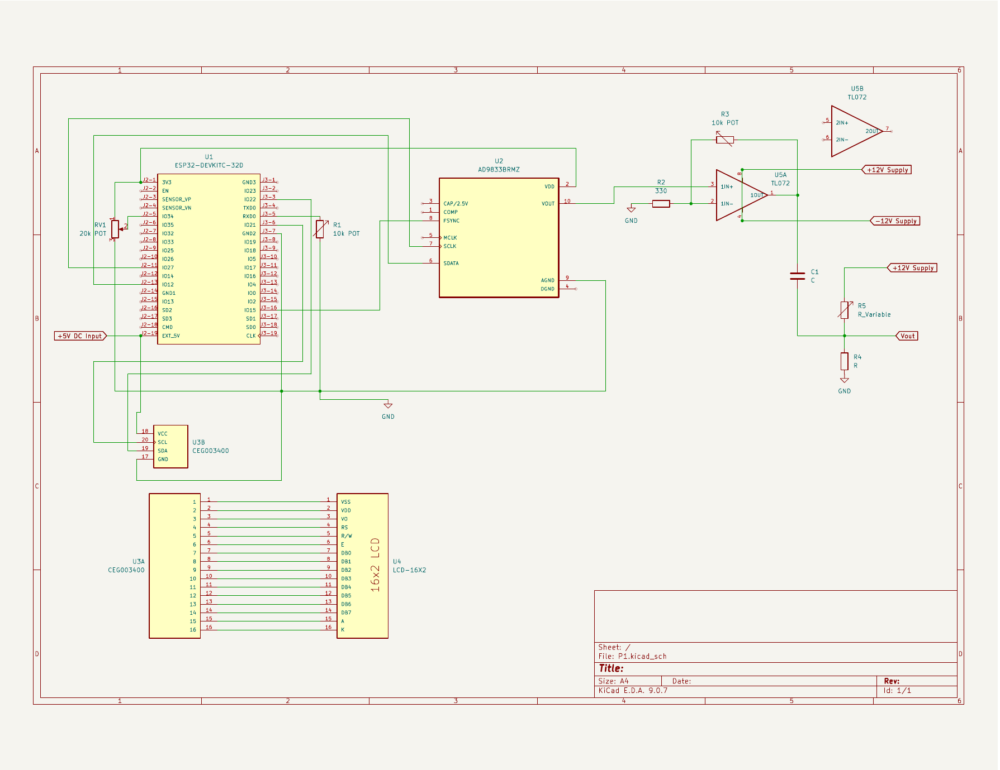
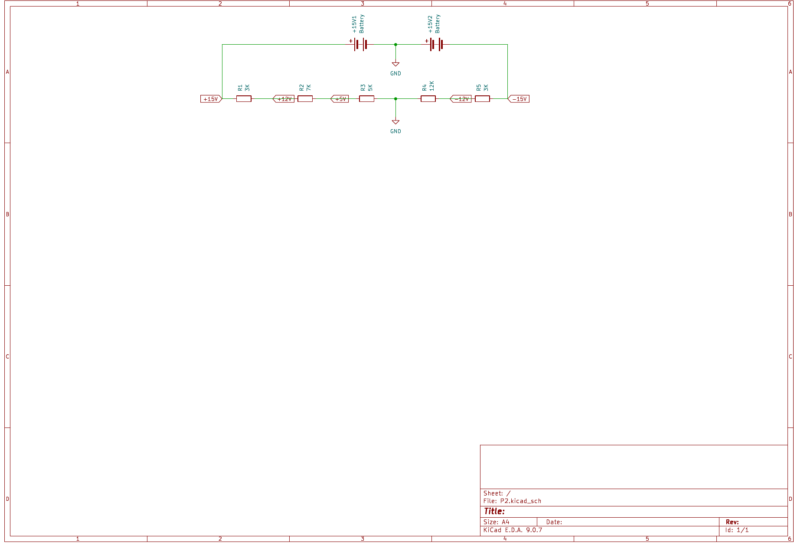
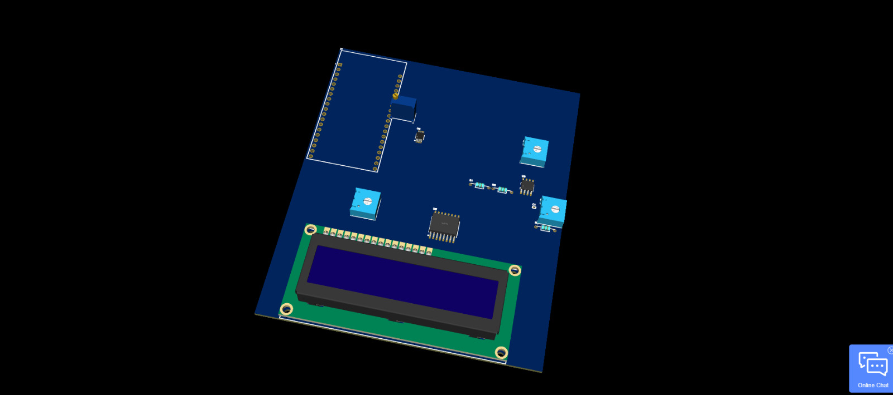
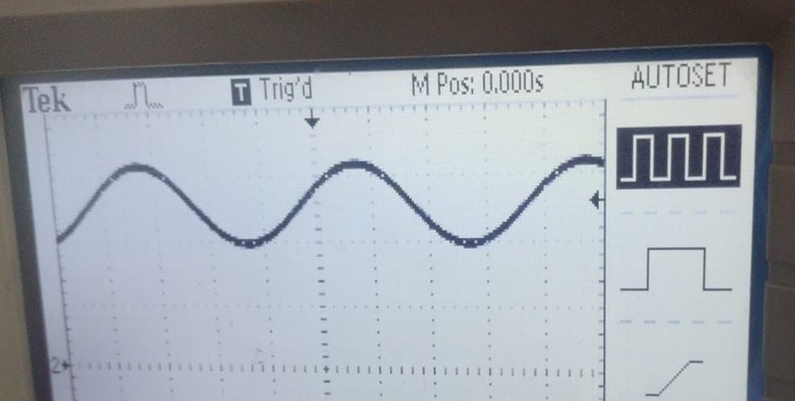
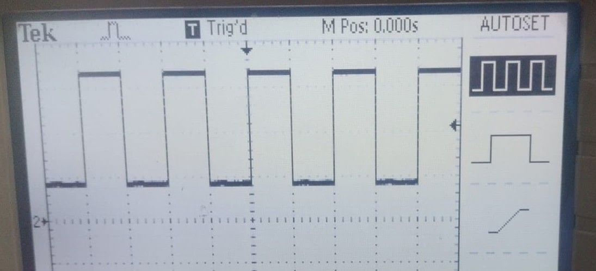
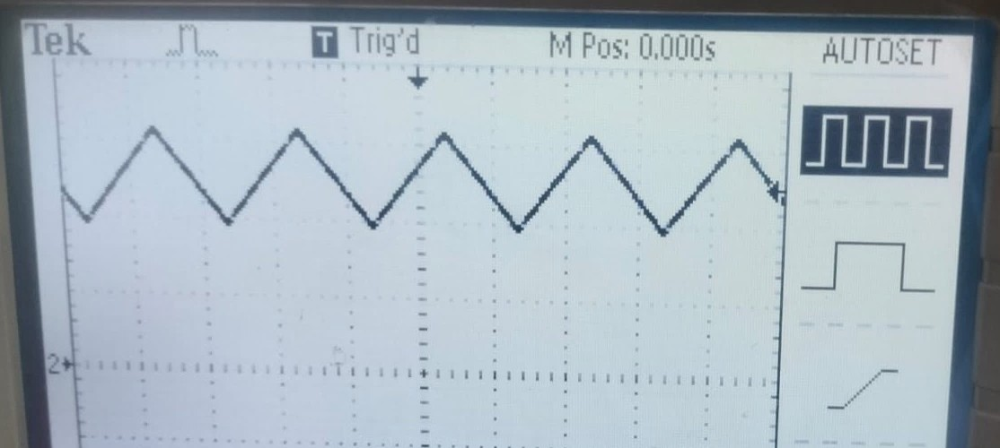
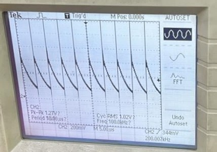
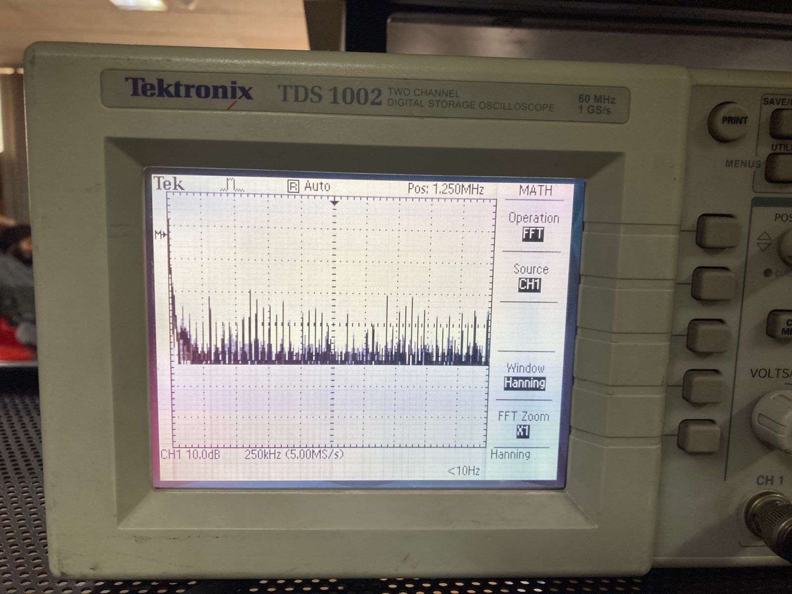

# DDS-Based Multi-Waveform Function Generator (ESP32 + AD9833)

A low-cost bench function generator for the ELP101 Basic Electronics Laboratory. An ESP32 programs an AD9833 DDS chip over SPI to produce sine, square, triangle and pulse waveforms. A TL072 op-amp stage adds gain and DC offset. A 16×2 I2C LCD, two push buttons and a potentiometer form the front panel.

| | |
|---|---|
| **Course** | ELP305 Design of Systems Lab, IIT Delhi |
| **Supervisor** | Prof. Subrat Kar |
| **Duration** | January–April 2026 |
| **Team** | ELP305 Monday Tribe: about 85 students across documentation, research, design, software and hardware teams |
| **My role** | Kabir Kashyap, Tribe Sub-Coordinator, Hardware Team |

## How it works

```
Front panel (2 buttons + pot) -> ESP32 -> SPI -> AD9833 DDS -> TL072 gain stage -> offset network -> BNC out
                                     \-> I2C -> 16x2 LCD (waveform, frequency, amplitude setting)
```

The AD9833 uses direct digital synthesis. A 28-bit phase accumulator steps through a sine lookup table at the rate set by the frequency word, and an internal 10-bit DAC turns the samples into an analog signal. Sine and triangle come from the DAC output. The square wave is the chip's own square output. The pulse waveform uses that same square setting and is shaped afterwards in hardware (see the notes section).

## Hardware

| Block | Parts |
|---|---|
| Control | ESP32-DevKitC-32D |
| Waveform generation | AD9833BRMZ DDS module |
| Signal conditioning | TL072: U5A is a non-inverting amplifier whose gain is set by a 10 kΩ potentiometer (R3); the output is AC-coupled (C1) into a DC-offset network (R5 variable, R4) |
| Display | 16×2 HD44780 LCD with PCF8574 I2C backpack (address 0x27) |
| Inputs | Two push buttons; 20 kΩ potentiometer for frequency digits and amplitude setting; 10 kΩ potentiometer for gain |
| Output | BNC connector |
| Power | Two 15 V batteries in series for ±15 V; ±12 V and +5 V taken from a resistor divider |

**ESP32 pins** (from the firmware)

| Signal | GPIO |
|---|---|
| Wave button | 16 |
| Select button | 18 |
| Potentiometer | 34 |
| AD9833 FSYNC / SCK / SDATA (MOSI) | 15 / 14 / 13 |
| LCD SDA / SCL | Default I2C pins (21 / 22) |
| Vpp read-back, `latestcode.ino` only | 32, 33 |

### Schematics





### PCB

The PCB layout is in `hardware/pcb/`. Only exported images are included; the design source files were not part of the submission.



### Enclosure and simulation

`hardware/enclosure/` has the updated front-panel model from design cycle 2. `hardware/simulation/` has the LTspice run of the amplifier stage.

## Firmware

```
firmware/
  function_generator/                        modular version (main.ino renamed to match the folder)
    function_generator.ino  globals.*  interrupts.*  inputHandler.*  display.*  frequency.*  ad9833control.*
  combinedAD9833AndLcdTestingCodeWithoutPulse/   single-file version; this is the one listed in the report appendix
  latestcode/                                single-file version plus Vpp/offset read-back on GPIO 32/33
  tests/AD9833Testing/  tests/lcd_testing/   bring-up tests for the DDS and the LCD
```

Each sketch is in its own folder because the Arduino IDE requires the `.ino` file name to match its folder.

**Using it**
- The Wave button cycles through Sine, Square, Triangle and Pulse.
- The Select button moves a blinking cursor across the 7 frequency digits, and then onto the amplitude field.
- The potentiometer sets the selected digit (0–9) or the amplitude value (0–9).
- The firmware limits the frequency to whole hertz from 1 Hz to 1 MHz. Each change is sent to the AD9833 over SPI.

**Building**
- Board: ESP32 Dev Module, using the ESP32 Arduino core.
- Libraries: `LiquidCrystal_I2C`, plus an `AD9833` library. The calls (`AD9833 gen(FSYNC)`, `setWave(AD9833_SINE)`, `AD9833_SQUARE1`, `setFrequency`) match Rob Tillaart's AD9833 library.
- SPI uses custom pins: `SPI.begin(14, -1, 13, 15)`.

## Results

Oscilloscope measurements from the report:

| Waveform | Frequency | Peak-to-peak | Mean |
|---|---|---|---|
| Sine | 102 kHz | 480 mV | 1.20 V |
| Square | 100 kHz | 2.64 V | 2.08 V |
| Triangle | 998 Hz | 620 mV | 1.07 V |
| Pulse | 100 kHz | 1.27 V | 1.02 V (RMS) |

| Sine | Square | Triangle | Pulse |
|---|---|---|---|
|  |  |  |  |

**THD.** The oscilloscope FFT has a 10 dB/div scale. The 2nd harmonic sits about 40 dB below the fundamental, and the 3rd about 45 dB below:

THD = √(V₂² + V₃²) / V₁ = √(0.01² + 0.0056²) ≈ 1.15%



**User validation.** Students outside the hardware team tested the prototype using only the device and its manual, over four weeks. Satisfaction scores went from 0.890 (week 1, biased) to 0.545 (week 2, once testing was independent), then 0.747 and 0.830 as fixes went in. The main complaints were amplitude instability, loose breadboard wiring, and panel labels that didn't match the manual. Design cycle 2 responded with a soldered perfboard, a tilted LCD panel and a cleaner front panel.

## Notes and limitations

**Stated in the report**
- The working frequency range was 100 Hz–10 kHz. The reference instrument covers 0.3 Hz–3 MHz.
- Output amplitude was far below the 20 Vpp target (480 mV sine, 620 mV triangle), and users reported it was unstable.
- Pulse shares the square-wave path. A dedicated differentiator stage was planned but not built.
- The supply is battery-based, so it drifts over time.
- TTL output, trigger output, FM input and protection circuits were specified but not implemented.

**From reading the code**
- `freqStr` is declared as `char freqStr[7]` and filled with 7 digits, so there is no terminating `'\0'`. `atol(freqStr)` reads past the end of the array and only works if the next byte in memory happens to be zero. Declaring it as `char freqStr[8]`, with `'\0'` as the last element, fixes this.
- The amplitude value (0–9) is only shown on the LCD and is never sent to the hardware. The actual gain is set by the R3 potentiometer.
- `PULSE` and `SQUARE` both send `AD9833_SQUARE1`.

**My interpretation, not tested**
- A resistor divider is not a regulator. The ±12 V and +5 V nodes in the power schematic will sag as soon as they supply real current.

## Contributions

This was a tribe-scale group project. The report lists about 85 members across five teams (documentation, research, design, software and hardware), each with coordinators. I was a Tribe Sub-Coordinator in the hardware team. The firmware and PCB files here come from the tribe's shared repositories.
